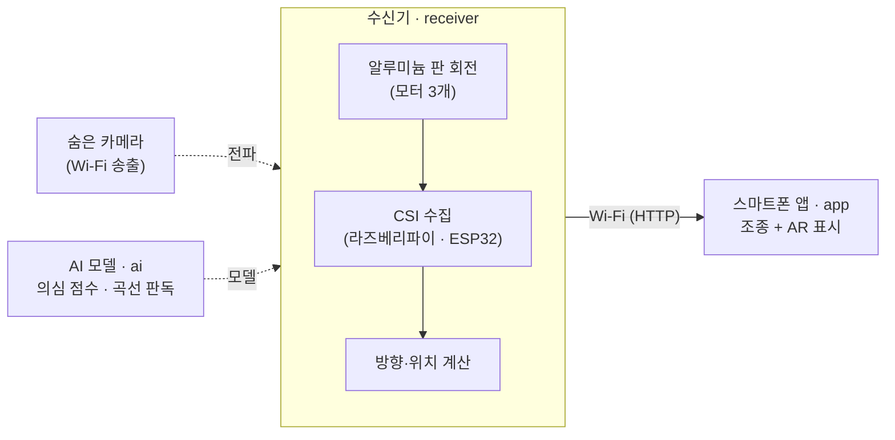

 

-10304F?style=flat-square)

## 무엇을 만드나

몰래 설치된 카메라와 시험 부정행위에 쓰이는 초소형 카메라 가운데 **Wi-Fi 로 영상을 내보내는 것**을 찾고, 그 카메라가 **어디에 있는지**까지 알려 주는 시스템입니다.

1. **탐지** — 둘레의 Wi-Fi 신호를 듣고, 카메라처럼 보내는 기기를 증거 점수로 가려냅니다.
2. **위치 추정** — 안테나 둘레로 알루미늄 판을 돌려, 신호가 가려지는 모양으로 카메라가 있는 방향을 잽니다. 여러 곳에서 잰 결과를 겹쳐 자리를 좁힙니다.
3. **표시** — 스마트폰 AR 화면에 의심 구역(시험장에서는 자리 후보)을 띄웁니다.

## 저장소

| | 저장소 | 내용 |
|---|---|---|
| 📡 | [**receiver**](https://github.com/DeteCam/receiver) | 수신기: 3D 모델·출력 파일, 펌웨어, 전파 시뮬레이션, 브라우저 시뮬레이터 |
| 📱 | [**app**](https://github.com/DeteCam/app) | 스마트폰 앱 (Android · Kotlin · ARCore): 수신기 조종, AR 의심 구역 표시 |
| 🧠 | [**ai**](https://github.com/DeteCam/ai) | AI 모델: 의심 점수(카메라 판별), CSI 곡선 판독 |
| 📚 | [**docs**](https://github.com/DeteCam/docs) | 프로젝트 문서: 원칙, 시스템 명세, 설계서, 조사, 검증 보고서 |

바로 보기: [▶ 수신기 시뮬레이터](https://detecam.github.io/receiver/) · [▶ 조립 영상](https://detecam.github.io/receiver/videos/) · [검증 보고서](https://github.com/DeteCam/docs/tree/main/verification)

## 일하는 방법

- **스펙 주도 개발(SDD)** — 저장소마다 `specs/번호-이름/` 아래에 `spec.md`(무엇을·왜) → `plan.md`(어떻게) → `tasks.md`(할 일) 순서로 쓰고, 그다음에 만듭니다. 프로젝트 원칙과 시스템 명세는 [docs](https://github.com/DeteCam/docs) 에 있습니다.
- **커밋·브랜치·PR 규칙** — [CONTRIBUTING.md](https://github.com/DeteCam/.github/blob/main/CONTRIBUTING.md)

## 범위

| 찾는 것 | 못 찾는 것 (범위 밖) |
|---|---|
| Wi-Fi 로 영상을 계속 내보내는 카메라 (공유기·폰 핫스팟에 붙었거나 스스로 AP 가 된 것, 2.4·5GHz) | 저장만 하는 카메라 (SD 카드) |
| 숨긴 네트워크에 붙은 카메라 | 블루투스로 폰에 보내는 기기 (스마트 안경 등) |
| 조용히 있는 카메라 (수신기가 찔러서 응답을 받는 방법, 확인 중) | LTE·5G 로 직접 보내는 카메라, 버튼을 누를 때만 잠깐 보내는 카메라 |

한국공학대학교 컴퓨터공학부 종합설계 (2026~2027)
