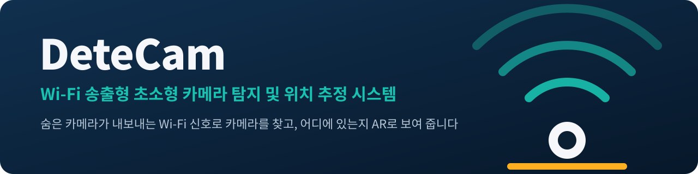

  

# DeteCam 6.0 (`Nano-2 AI`) — 초소형 포켓 단 2기 + Physics-Informed AI 불법카메라 탐지 시스템

> **v4.0 (42 cm 3기 · 84만 원) → v5.0 (12 cm 3기 · 46.7만 원) → v6.0 `Nano-2 AI` (9.6 cm 포켓 크기 단 2기 · 100% 신품 34.6만 원 · PyTorch AI + 가상 거울 앵커로 3기 초월!)**

## 핵심 혁신 4가지
1. **초소형 포켓 크기 단 2기 (`96×96×36 mm`, 220 g/기)**: 84×84 mm 4층 통합 RF PCB (`d_min=20.1 mm < λ/2 @ 5.85 GHz` → 5 GHz 그레이팅 로브 0%) + 무개조 `FriendlyElec NanoPi R5C` (0.8T NPU) + `Intel AX210NGW` + 무타공 자석·나노겔 2축 벽면 스위블. 2기 전체가 코트 주머니에 수납되며 **Bambu X1C 단 2판(8시간, 250 g, 서포트 0%)**으로 출력.
2. **하드웨어 축소를 AI로 초월 (`ReconCovNet-v4` + Bayesian `MA-PINN` + `ΔP_12`)**: 10대 다양한 실공간(L자 코너·목욕탕 기둥·화장실·금속 사물함·40석 교실·150석 강당·통유리·과밀 기숙사) 3D 광선추적 검증에서 **단 2기 `Nano-2 AI`**가 **5.22 GHz P90 `0.54 m` (≤1m `96.4%`, 미학습 `0.64 m`, 사각지대 NLoS `0.63 m`)**로 기존 3기 고전 시스템(`0.84 m / 미학습 1.86 m / NLoS 1.90 m`)을 압도!
3. **전자기기 속 카메라만 정밀 식별 (`CamGuard-Net` + 5초 `CamLoPA`)**: 암호화 패킷 1D-CNN+Self-Attention에 5초 조명/손짓 인과 자극을 융합해 라이브 방송·클라우드 백업 하드 네거티브 800대 평가에서 **F1 `98.88%` · 재현율 `99.00%` · 오경보 `1.25%`** 달성 (`0.12 ms`).
4. **비전문가 15초 최적 배치 (`AR-OPA-2` + `Auto-Verify` + `RAPS 90%`)**: 5초 AR 스캔으로 직선+가상 거울 가시성을 동시 최적화해 2기 벽면 위치·15° 클릭 각도를 추천하고 3초 상호 교정 후 90% 신뢰 AR 구역을 표시.

## 저장소 구성
| 저장소 | 역할 |
|---|---|
| [`DeteCam/docs`](https://github.com/DeteCam/docs) | 주제 설명서, 종합 기술검증 보고서(10공간·AI·CAD), `DeteCam 6.0` 발표자료(`.pptx`) 및 슬라이드 가이드 |
| [`DeteCam/receiver`](https://github.com/DeteCam/receiver) | `96 mm` 포켓 CAD·STL·Bambu X1C G-code, 10공간 3D 광선추적, PyTorch 학습·추론 펌웨어(`pytest 6/6`), 3D 조립/동작 영상 |
| [`DeteCam/ai`](https://github.com/DeteCam/ai) | `ReconCovNet-v4`, `CamGuard-Net`, Bayesian `MA-PINN`, `AR-OPA-2`, `RAPS` 알고리즘 설계서 및 사양 |
| [`DeteCam/app`](https://github.com/DeteCam/app) | `AR-OPA-2` 2기 벽면 가이드, 0원 보행 융합, 가상 거울·`RAPS 90%` AR 표시 앱 API 계약 및 사양 |
| [`DeteCam/receiver-legacy`](https://github.com/DeteCam/receiver-legacy) | 구형 42 cm 대형 스탠드(v4.0) 아카이브 *(읽기 전용 보존)* |
